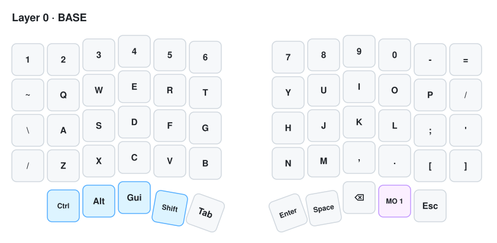
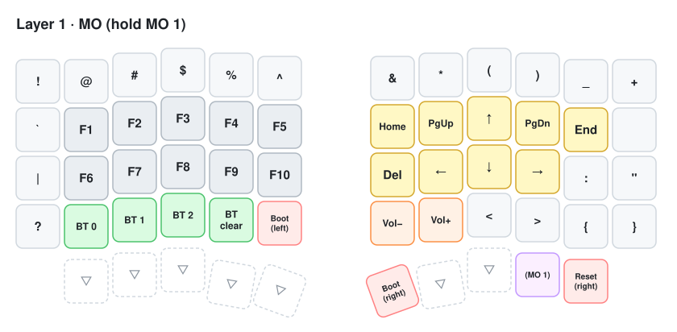

# Wireless Sofle · ZMK config

[ZMK](https://zmk.dev) configuration for my wireless split Sofle. The whole keyboard is 3D printed and hand-wired, with two nRF52840 boards (SuperMini, `nice_nano_v2` compatible). The battery level of each half is shown on a small ESP32 desk robot.


## Keymap

There are two layers. Layer 0 is for normal typing, and layer 1 is active **while holding** the `MO 1` key (right thumb).

### Layer 0 · BASE



QWERTY with a number row on top. All modifiers (`Ctrl`, `Alt`, `Gui`, `Shift`) sit on the left thumb cluster. The right thumb cluster has `Enter`, `Space`, `Backspace`, the layer key and `Esc`.

### Layer 1 · MO



| Area | What it does |
|---|---|
| Top row | Shifted symbols (`! @ # $ % ^ & * ( ) _ +`) without pressing Shift |
| Left side | `F1`–`F10` |
| Right side | Inverted-T arrows (`↑ ← ↓ →`), plus `Home`, `End`, `PgUp`, `PgDn` and `Del` |
| `BT 0` / `BT 1` / `BT 2` | Select a Bluetooth profile (`BT 2` is used by the robot, see below) |
| `BT clear` | Clear the pairing of the **active** profile |
| `Vol−` / `Vol+` | System volume |
| `Boot (left)` | Put the **left** half into bootloader mode for flashing |
| `Boot (right)` / `Reset (right)` | Bootloader or reset for the **right** half |
| `▽` | Transparent: falls through to the BASE layer |

> In ZMK, `&bootloader` and `&sys_reset` act on the half where the key physically is. That's why there is a Boot key on each side.

The keymap uses **US** layout keycodes. If your OS uses a different layout (e.g. Latin American Spanish), some symbols will come out differently from what the diagrams show.

## Hardware

| | Left | Right |
|---|---|---|
| Board | nRF52840 SuperMini (`nice_nano_v2`) | nRF52840 SuperMini (`nice_nano_v2`) |
| Role | **Central**: connects to the computer via USB or Bluetooth | Peripheral: connects to the left half |
| Case | 3D printed | 3D printed |
| Matrix | 5 rows × 6 columns | 5 rows × 6 columns |

Row 4 holds the thumb keys: 5 per side (C0 is unused on the left and C5 on the right). Diodes are `col2row`, and debounce is 20 ms for both press and release.

Since there's no PCB (the keyboard is 3D printed and hand-wired), the pins don't match an official Sofle PCB, and each half has its own:

<details>
<summary>Matrix pins</summary>

**Left** (`boards/shields/mi_sofle/mi_sofle_left.overlay`)

| | C0 | C1 | C2 | C3 | C4 | C5 |
|---|---|---|---|---|---|---|
| Column | P1.15 | P1.01 | P0.11 | P0.24 | P1.06 | P0.29 |

| | R0 | R1 | R2 | R3 | R4 |
|---|---|---|---|---|---|
| Row | P0.31 | P0.02 | P1.11 | P0.09 | P1.07 |

**Right** (`boards/shields/mi_sofle/mi_sofle_right.overlay`)

| | C0 | C1 | C2 | C3 | C4 | C5 |
|---|---|---|---|---|---|---|
| Column | P0.09 | P0.10 | P1.11 | P1.07 | P0.20 | P0.08 |

| | R0 | R1 | R2 | R3 | R4 |
|---|---|---|---|---|---|
| Row | P0.06 | P0.17 | P0.22 | P1.06 | P1.01 |

</details>

## Battery

The keyboard goes into deep sleep after **15 min** of inactivity and wakes up on any key press (`config/mi_sofle.conf`).

The left half (central) fetches the right half's battery level and publishes **both** over Bluetooth:

```
CONFIG_ZMK_BATTERY_REPORTING=y
CONFIG_ZMK_SPLIT_BLE_CENTRAL_BATTERY_LEVEL_FETCHING=y
CONFIG_ZMK_SPLIT_BLE_CENTRAL_BATTERY_LEVEL_PROXY=y
```

They show up as two standard Battery Level characteristics (`0x2A19`); the right half's one has the description `Peripheral`.

## Battery robot

A small desk robot shows the battery level of each half. It's an ESP32-C3 SuperMini with a 0.96" SSD1306 OLED (128×64) and a TTP223 touch sensor, powered over USB. It has three screens: animated faces, weather, and keyboard battery (`L` / `R` with an icon and percentage). A short touch switches screens, a long touch changes the face.

The robot connects to the keyboard over Bluetooth as one more host, on its own profile (`BT 2`), and subscribes to both battery levels. ZMK can stay connected to several hosts at once (only the active profile receives keystrokes), so the robot stays connected while you type on the computer.

**Pairing (once):**

1. On the keyboard, select an empty profile: `MO 1` + `BT 2`.
2. Power on the robot. It looks for a device named `Sofle` and pairs automatically.
3. Switch back to your computer's profile: `MO 1` + `BT 0`.

When the keyboard goes to sleep the robot shows the last known values and reconnects when it wakes up. If it doesn't, switching to `BT 2` and back forces it.

The robot code lives in [`robot/`](robot/). To build it in Arduino IDE:

- Install **NimBLE-Arduino 2.x**, **Adafruit SSD1306** and **ArduinoJson** from the Library Manager.
- Set *Tools → Partition Scheme → Huge APP (3MB No OTA)*: WiFi + Bluetooth don't fit in the default partition.
- Copy `secrets.example.h` to `secrets.h` and fill in your WiFi network. `secrets.h` is git-ignored.

## Repo structure

```
boards/shields/mi_sofle/   Custom shield: matrix and pins
config/mi_sofle.keymap     Keymap
config/mi_sofle.conf       Shared options (sleep, battery reporting)
config/mi_sofle_right.conf Right half options
config/west.yml            ZMK version (v0.3)
build.yaml                 Firmware targets built by GitHub Actions
robot/                     ESP32 battery robot (Arduino)
```

## Building and flashing

1. Every push builds the firmware on **GitHub Actions**. Download the `.zip` from *Artifacts* in the Actions tab.
2. Plug one half in via USB and enter the bootloader: double-tap the reset button, or press `MO 1` + that half's `Boot` key.
3. A USB drive shows up. Copy the matching `.uf2` onto it:
   - `mi_sofle_left-nice_nano_v2-zmk.uf2` → left half
   - `mi_sofle_right-nice_nano_v2-zmk.uf2` → right half
4. Repeat with the other half.

If the halves won't connect to each other, flash `settings_reset-nice_nano_v2-zmk.uf2` onto **both** halves, then flash the regular firmware on each side again.

If your board isn't a nice!nano v2 or compatible, change `board:` in `build.yaml`.
